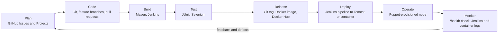

# Task 2: Agile Planning and DevOps Workflow

Project: Puppet-Provisioned Policyholder Grievance Portal
Date: 21 October 2026
Status: Draft for approval

## 1. Roles and statuses used in the stories

- Roles: Policyholder, Officer (grievance officer), Admin.
- Grievance statuses: Submitted, Under Review, Resolved, Rejected, Closed.
- Each story below matches the MVP item with the same number in `01-problem-definition.md`.

## 2. User stories and acceptance criteria

| ID | User story | Acceptance criteria |
| --- | --- | --- |
| US-01 | As a user, I want to log in and out so that I only see what my role allows. | AC1: Valid credentials open the home page for my role. AC2: Invalid credentials show an error and no session. AC3: Logout ends the session, and protected pages then redirect to login. |
| US-02 | As a policyholder, I want to submit a grievance so that my complaint is recorded and acknowledged at once. | AC1: The form takes policy number, category and description (3 fields, plus a title). AC2: On submit I see a reference ID and a due date of submission + 14 days. AC3: The new grievance has status Submitted. |
| US-03 | As a policyholder, I want to see a list of my grievances so that I can track them. | AC1: The list shows reference ID, category, status and due date. AC2: I see only my own grievances. AC3: An empty list shows a clear message. |
| US-04 | As a user, I want to open a grievance and see its status history so that I know what has happened. | AC1: The detail page shows all fields and the current status. AC2: The history lists each status change with who made it and when. AC3: A policyholder cannot open another policyholder's grievance. |
| US-05 | As a policyholder, I want to correct my grievance while it is still Submitted so that mistakes do not delay handling. | AC1: Edit is available only when status is Submitted. AC2: Saving updates the record and keeps the reference ID and due date. AC3: Once review starts, the edit option is gone. |
| US-06 | As an officer or admin, I want a list of all grievances so that I can see the queue. | AC1: The list shows every grievance with status and due date. AC2: Policyholders cannot reach this page. AC3: The list is ordered by due date, earliest first. |
| US-07 | As an officer or admin, I want to search and filter so that I can find a grievance quickly. | AC1: I can search by reference ID or policy number. AC2: I can filter by status and by category. AC3: Filters combine, and no results shows a clear message. |
| US-08 | As an officer, I want to pick up a grievance so that it has one clear owner. | AC1: Picking up a Submitted grievance assigns it to me and moves it to Under Review. AC2: The assigned officer is shown on the detail page. AC3: A grievance already assigned cannot be picked up by another officer. |
| US-09 | As an admin, I want status changes to follow fixed rules so that the workflow stays controlled. | AC1: Officer may move Submitted to Under Review and Under Review to Resolved or Rejected. AC2: Admin may move Resolved or Rejected to Closed, and Resolved back to Under Review. AC3: Any other change, and any change by a policyholder, is rejected with a message. |
| US-10 | As a policyholder, I want a reason when my grievance is resolved or rejected so that I understand the outcome. | AC1: Resolving or rejecting requires a resolution note. AC2: An empty note is refused. AC3: The note appears on the detail page and in the history. |
| US-11 | As an admin, I want to close or reopen a resolved grievance so that the final state is controlled. | AC1: Close moves Resolved or Rejected to Closed. AC2: Reopen moves Resolved to Under Review. AC3: Both actions are recorded in the history. |
| US-12 | As an officer, I want overdue grievances flagged so that I can act before the deadline is missed. | AC1: Due date is submission + 14 days. AC2: An open grievance past its due date shows an Overdue flag in lists and on the detail page. AC3: Resolved, Rejected and Closed grievances are never flagged. |
| US-13 | As an admin, I want a summary dashboard so that I can see the backlog at a glance. | AC1: It shows counts by status and by category. AC2: It shows the number of overdue grievances. AC3: The counts match the list view. |
| US-14 | As a user, I want clear validation and error pages so that I know what to fix. | AC1: Empty or invalid fields show a message next to the field. AC2: An unknown URL shows a friendly 404 page. AC3: A server error shows a friendly error page with no stack trace. |
| US-15 | As an operator, I want a health endpoint and demo data so that deployments can be verified and demonstrated. | AC1: `/health` returns HTTP 200 and the application version. AC2: A fresh start seeds demo users and sample grievances. AC3: Seeding does not duplicate data on restart. |

## 3. Product backlog

Priority uses MoSCoW. Points use the Fibonacci scale: 1 is trivial, 5 is the largest item in the MVP.

| Rank | ID | Item | Priority | Points | Sprint |
| --- | --- | --- | --- | --- | --- |
| 1 | US-01 | Login and logout with three roles | Must | 3 | 1 |
| 2 | US-02 | Submit a grievance | Must | 5 | 1 |
| 3 | US-03 | My grievances list | Must | 2 | 1 |
| 4 | US-15 | Health endpoint and demo data | Must | 2 | 1 |
| 5 | US-04 | Grievance detail with history | Must | 3 | 2 |
| 6 | US-06 | All-grievances list | Must | 2 | 2 |
| 7 | US-07 | Search and filter | Must | 3 | 2 |
| 8 | US-05 | Edit while Submitted | Should | 3 | 2 |
| 9 | US-12 | Due date and overdue flag | Should | 2 | 2 |
| 10 | US-14 | Validation and error pages | Should | 2 | 2 |
| 11 | US-09 | Role-based status workflow | Must | 5 | 3 |
| 12 | US-13 | Summary dashboard | Must | 5 | 3 |
| 13 | US-08 | Officer picks up a grievance | Should | 2 | 3 |
| 14 | US-10 | Resolution note | Should | 2 | 3 |
| 15 | US-11 | Admin close and reopen | Should | 2 | 3 |

Total: 43 points.

## 4. Sprint plan

| Sprint | Course task | Goal | Items | Points |
| --- | --- | --- | --- | --- |
| 1 | Task 5 | A policyholder can log in, submit and list grievances, on a feature branch merged through a pull request. | US-01, 02, 03, 15 | 12 |
| 2 | Task 6 (first half) | Officers can see, search and inspect every grievance, with due dates. | US-04, 05, 06, 07, 12, 14 | 15 |
| 3 | Task 6 (second half) | The status workflow and dashboard are complete, and `v1.0.0` is tagged. | US-08, 09, 10, 11, 13 | 16 |

Sprint 2 and 3 include the second feature branch and the deliberate merge conflict
required by Task 6.

## 5. Kanban board

The 15 backlog items are the 15 cards. In Task 4 they become GitHub issues on a GitHub Projects board.

- Columns: Backlog, Ready, In Progress, In Review, Done.
- Work-in-progress limit: 2 cards In Progress, and 2 In Review.
- Start state: Sprint 1 cards in Ready, the other 11 in Backlog.
- A card moves to In Review when a pull request is open, and to Done only when the Definition of Done is met.

## 6. Definition of Done

A card is Done only when all of these are true:

- [ ] Code is on a feature branch named `feature/<short-name>` and merged into `develop` through a reviewed pull request.
- [ ] Every acceptance criterion of the story is met and demonstrated.
- [ ] Unit tests for the change pass, and `mvn clean package` succeeds.
- [ ] Once Jenkins exists (Task 7), the Jenkins build for the merge is green.
- [ ] Once Selenium tests exist (Task 9), the tests covering the story pass.
- [ ] No passwords, tokens or real personal data are committed.
- [ ] README or docs are updated if behaviour or setup changed.
- [ ] The card is moved to Done and its issue is closed with a link to the pull request.

## 7. DevOps lifecycle

| Stage | Tools | Introduced in |
| --- | --- | --- |
| Plan | Backlog, GitHub Issues and Projects | Tasks 2 and 4 |
| Code | Git, GitHub, branching and pull requests | Tasks 4 to 6 |
| Build | Maven (WAR), Jenkins job | Tasks 3 and 7 |
| Test | JUnit, Selenium WebDriver, Jenkins test report | Tasks 9 and 10 |
| Release | Git tag, versioned Docker image, Docker Hub | Tasks 6, 11 and 12 |
| Deploy | Jenkinsfile pipeline, Tomcat, Docker container | Tasks 8 and 12 |
| Operate | Puppet manifests, provisioned target node | Tasks 13 and 14 |
| Monitor | `/health` endpoint, logs, rollback to previous release | Task 14 |