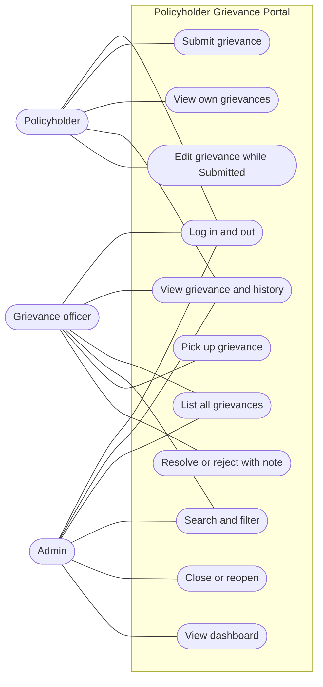
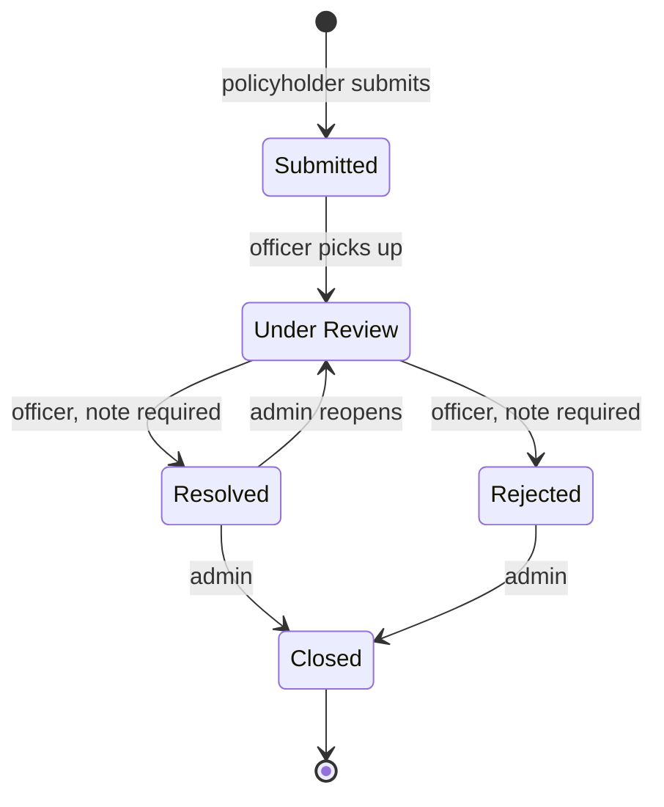
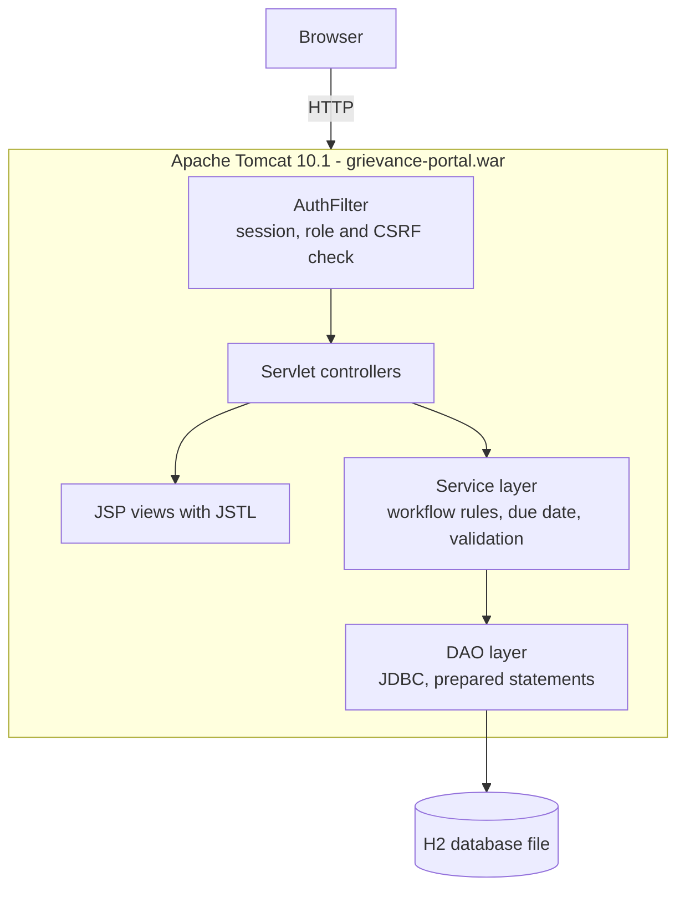
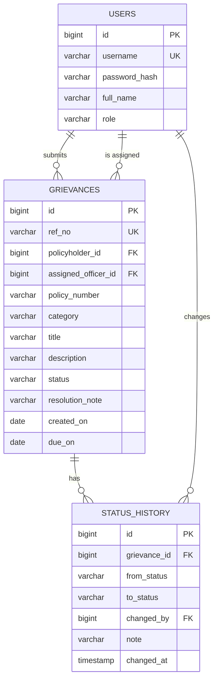

# Task 3: Requirements, Architecture and Technology Setup

Project: Puppet-Provisioned Policyholder Grievance Portal
Date: 21 October 2026
Status: Draft for approval

## 1. SRS summary

### 1.1 Purpose and scope

The portal records insurance grievances from submission to closure, enforces a
role-based status workflow, flags grievances past their 14-day due date, and shows a
summary dashboard. It is a single web application with one database. The 15 MVP items
are in `01-problem-definition.md` and their stories in `02-agile-plan.md`.

### 1.2 Functional requirements

| Group | Requirement | Stories |
| --- | --- | --- |
| Access | Users log in with a username and password and see only what their role allows. | US-01 |
| Capture | A policyholder submits a grievance and receives a reference ID and due date. | US-02 |
| Tracking | Policyholders list their own grievances. Every user can open a grievance they may see and read its status history. | US-03, US-04 |
| Update | A policyholder edits a grievance only while it is Submitted. | US-05 |
| Search | Staff list all grievances and search by reference ID or policy number, and filter by status and category. | US-06, US-07 |
| Workflow | Officers pick up grievances and resolve or reject them with a note. Admins close or reopen. All other changes are refused. | US-08, 09, 10, 11 |
| SLA | Due date is submission + 14 days. Open grievances past it are flagged Overdue. | US-12 |
| Dashboard | Admins see counts by status and category, and the overdue count. | US-13 |
| Quality | Forms validate input, and errors show friendly pages. | US-14 |
| Operations | `/health` reports status and version, and demo data seeds on first start. | US-15 |

### 1.3 Non-functional requirements

| ID | Requirement |
| --- | --- |
| NFR-01 | Security: passwords are stored as salted PBKDF2 hashes. All SQL uses prepared statements. The session cookie is HttpOnly. Every protected URL checks the role on the server. Every POST form carries a CSRF token. |
| NFR-02 | Portability: `mvn clean package` on JDK 17 produces one WAR that runs unchanged on Tomcat 10.1 on Windows, Linux and in Docker. |
| NFR-03 | Configuration: the database path and the environment name come from environment variables, never hard-coded. This is what Tasks 8, 12 and 14 will parameterise. |
| NFR-04 | Performance: list pages respond in under 2 seconds with 1,000 grievances. |
| NFR-05 | Testability: every form field and button has a stable HTML `id` for Selenium. Core flows work without JavaScript. |
| NFR-06 | Operability: version is read from the build, and logs go to the standard Tomcat log. |
| NFR-07 | Data: only synthetic data is used. No secrets are committed. |

### 1.4 Assumptions

- Users and passwords are seeded. There is no self-registration.
- One officer owns a grievance at a time.
- Time is handled in the server's local date. Due dates are dates, not timestamps.

## 2. Use-case diagram

## 3. Status workflow

| From | To | Allowed role | Note required |
| --- | --- | --- | --- |
| Submitted | Under Review | Officer | No |
| Under Review | Resolved | Officer | Yes |
| Under Review | Rejected | Officer | Yes |
| Resolved | Closed | Admin | No |
| Rejected | Closed | Admin | No |
| Resolved | Under Review | Admin | Yes (reason for reopening) |

Every other change is refused, and every allowed change adds a row to the status history.

## 4. Architecture

| Layer | Package or location | Responsibility |
| --- | --- | --- |
| Filter | `com.grievanceportal.filter` | Login check, role check, CSRF token |
| Controllers | `com.grievanceportal.controller` | Read the request, call a service, pick a view |
| Services | `com.grievanceportal.service` | Business rules: workflow, due date, overdue |
| DAO | `com.grievanceportal.dao` | All SQL |
| Model | `com.grievanceportal.model` | Plain Java classes: User, Grievance, StatusChange |
| Views | `src/main/webapp/WEB-INF/views` | JSP pages, not reachable by direct URL |

Configuration (environment variables, with defaults):

| Variable | Default | Purpose |
| --- | --- | --- |
| `GP_DB_PATH` | `${catalina.base}/data/grievance-db` under Tomcat, otherwise `./data/grievance-db` | Location of the H2 database file |
| `GP_ENV_NAME` | `local` | Environment label shown in the page footer |

## 5. Technology stack (final)

| Layer | Choice |
| --- | --- |
| Language | Java 17 (Eclipse Temurin) |
| Web | Jakarta Servlet 6.0 and JSP 3.1 on Apache Tomcat 10.1 |
| View helpers | JSTL 3.0 |
| Build | Maven 3.9, packaging a WAR |
| Database | H2 2.2 in file mode |
| Unit tests | JUnit 5 |
| UI tests | Selenium WebDriver 4 with headless Chrome |
| CI and CD | Jenkins LTS, Jenkinsfile |
| Containers | Docker, Docker Hub |
| Configuration management | Puppet |

## 6. Data model

- `role` is one of POLICYHOLDER, OFFICER, ADMIN.
- `status` is one of SUBMITTED, UNDER_REVIEW, RESOLVED, REJECTED, CLOSED.
- `category` is one of CLAIM_SETTLEMENT, PREMIUM_AND_BILLING, POLICY_SERVICING, MIS_SELLING, OTHER.
- `ref_no` looks like `GRV-2026-0001`.
- Overdue is calculated (open status and today after `due_on`), not stored.

## 7. URL list

| Method | URL | Role | Purpose | Story |
| --- | --- | --- | --- | --- |
| GET | `/login` | Anyone | Login form | US-01 |
| POST | `/login` | Anyone | Log in | US-01 |
| POST | `/logout` | Logged in | Log out | US-01 |
| GET | `/grievances/new` | Policyholder | Submission form | US-02 |
| POST | `/grievances` | Policyholder | Create a grievance | US-02 |
| GET | `/grievances/mine` | Policyholder | Own grievances | US-03 |
| GET | `/grievances/view?id=` | Owner or staff | Detail and history | US-04 |
| GET | `/grievances/edit?id=` | Policyholder | Edit form | US-05 |
| POST | `/grievances/edit` | Policyholder | Save edit | US-05 |
| GET | `/grievances` | Officer, Admin | All grievances, with `q`, `status`, `category` | US-06, US-07 |
| POST | `/grievances/pickup` | Officer | Pick up | US-08 |
| POST | `/grievances/status` | Officer, Admin | Change status per the table in section 3 | US-09, 10, 11 |
| GET | `/dashboard` | Admin | Summary counts | US-13 |
| GET | `/health` | Anyone | Status and version | US-15 |